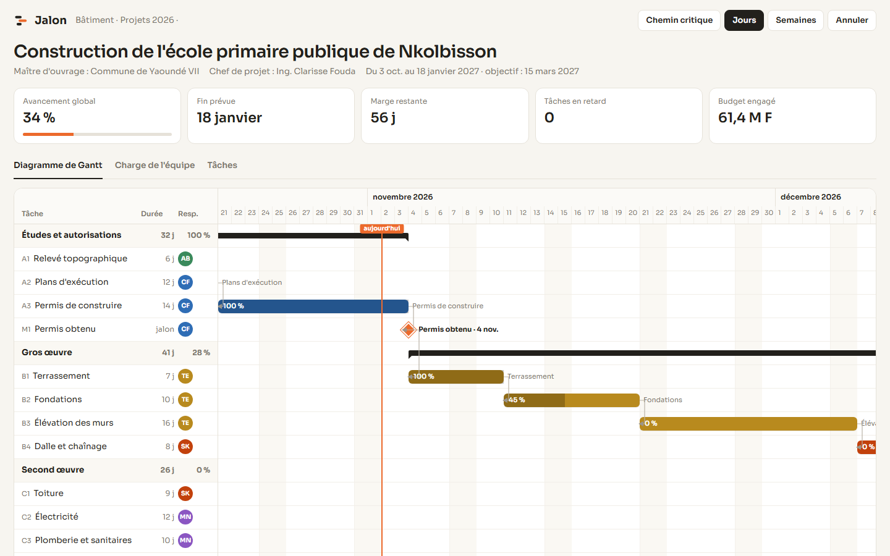
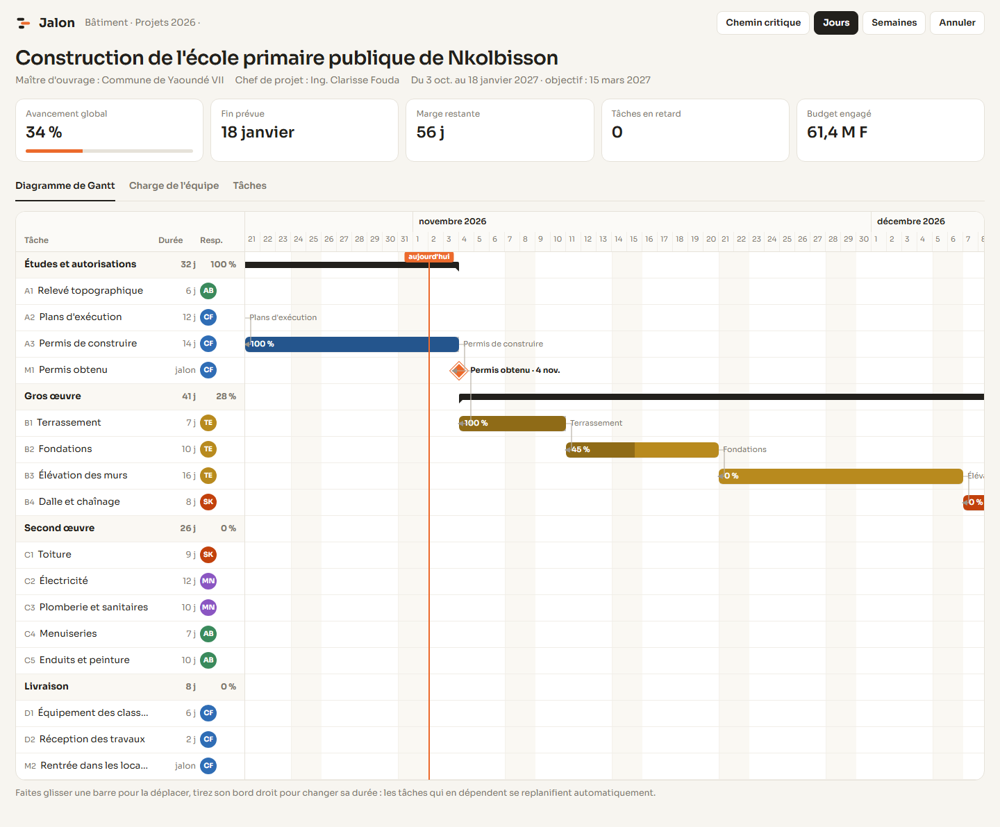
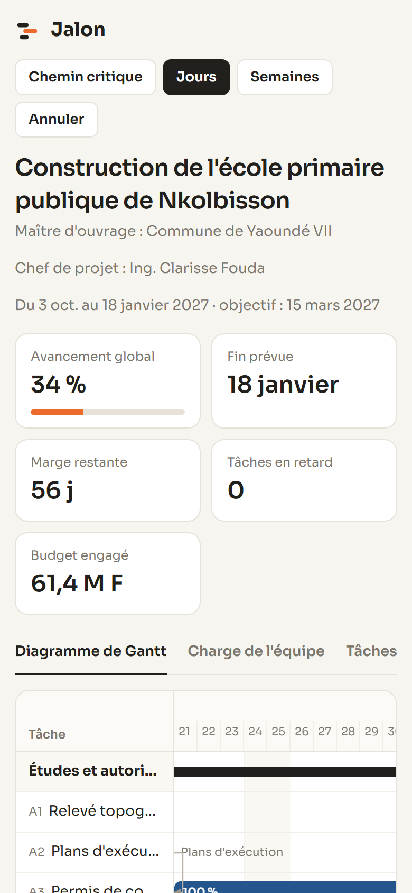

# Jalon

**Planification de projet et diagramme de Gantt** — Outil de planification pour un chantier (construction d'une école) : diagramme de Gantt interactif avec phases, jalons et dépendances, barres déplaçables et redimensionnables, replanification automatique des tâches qui suivent, chemin critique, vue jours ou semaines, charge hebdomadaire de l'équipe et tableau des tâches.

**Démo en ligne : [https://lordlennyx.github.io/jalon-gantt/](https://lordlennyx.github.io/jalon-gantt/)**

Spot de présentation (30 s) : [media/spot-30s.mp4](https://lordlennyx.github.io/jalon-gantt/media/spot-30s.mp4)

## Ce que le projet montre

- Gantt : phases, tâches, jalons, week-ends, ligne du jour, flèches de dépendance
- Glisser pour déplacer, tirer pour allonger : les successeurs se replanifient (fin-début) avec animation, annulation
- Chemin critique calculé (dates au plus tard) et mis en évidence
- Indicateurs : avancement pondéré, date de fin, marge sur l'objectif, retards
- Charge hebdomadaire par personne avec détection des surcharges
- Vue tâches à faire, en cours, terminées

## Réalisation

- **Stack :** HTML, CSS, JavaScript natif, SVG, Pointer Events
- **Typographies :** Sora, JetBrains Mono
- **Évolutions possibles :** export PDF et MS Project, collaboration en temps réel, suivi des coûts, application mobile de pointage chantier

| Bureau | Mobile |
|---|---|
|  |  |

---

Client et contenus fictifs, créés pour la démonstration. Conception, design et développement : **Njundiyimun Béchard** — [github.com/LordLennyx](https://github.com/LordLennyx)
